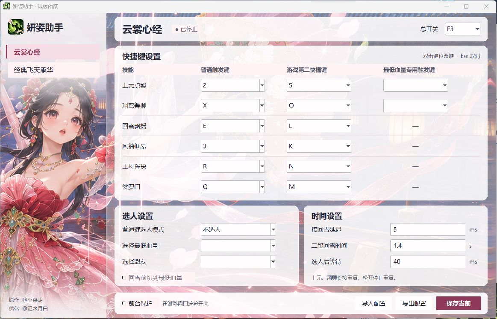
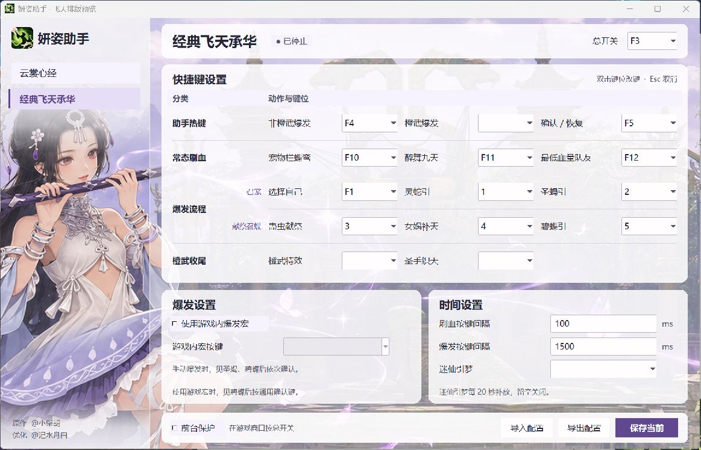

# 【苍生铸世】妍姿助手新版使用说明与更新大全

4 月的测试版主要帮云裳少按几次回雪。现在云裳可以用游戏内快捷键选人，另外也加上了经典飞天承华，能刷常态、分段打爆发和定时补迷仙引梦。两个流派从左侧切换，键位和时间都可以自己调。

助手按预设顺序发送快捷键。选到谁由游戏决定，目标身上的 HOT、宠物有没有出来、技能有没有放成，还得自己看。开飞天爆发时尤其记得看圣蝎和碧蝶。

## 安装和换新版

1. **先关旧助手**，把新版 ZIP 完整解压到一个本地文件夹。旧键位想继续用，就把原来的 `config.ini` 备份一份，再复制到新版 `YanziHelper.exe` 旁边。以前用过免驱测试版的配置也可以这样带过来。
2. Windows x64 上，**手上有含驱动包**就双击里面的「启动助手.exe」，按提示允许管理员权限。已经装好匹配的 DD HID 63340 会直接打开助手。缺驱动时按原厂安装程序提示操作，需要重启就重启后再开。让启动器、助手和 `driver` 文件夹留在一起。**已经装好 63340 的电脑**也可以从标准包直接打开 `YanziHelper.exe`。
3. 打开后先看左侧流派和右上角「总开关」，确认游戏里的技能和选人快捷键，再点「保存当前」。切回游戏按一次总开关启动，再按一次停止。云裳显示「运行中」后等你按技能键，飞天显示「常态刷血」后会立刻开始循环。

**改键**时先停助手。双击键位框的文字区域，按一个新键，再点「保存当前」。`Esc` 取消，`Backspace` 或 `Delete` 清空，也可点右边箭头从列表选。支持字母、主键盘数字、`F1`–`F12`、小键盘数字、`Tab` 和空格这些单键。想换电脑或留一份用来恢复，点「导出配置」。点「导入配置」会校验并保存所选的配置。

**前台保护**在左下角，默认关闭。勾选后，先把游戏切到前台，再按总开关。切到其他窗口会自动停止，切回游戏后要自己再按一次总开关。想改键或换流派，也先停掉当前流程。

## 云裳心经

### 先把三类键位配好

- **普通触发键**是你平时按的键。上元、翔舞用它启动对应的 HOT 加接回雪流程。
- **游戏第二快捷键**是助手发给游戏的键。请在游戏里给上元点鬟、翔鸾舞柳、回雪飘摇绑好各自的第二快捷键，再照着填进助手。比如上元普通触发键填 `2`，游戏里的上元第二快捷键绑 `S`，助手的上元第二快捷键就也填 `S`。
- **最低血量专用触发键**上元、翔舞各有一个，留空就不用。按下后固定走「选择最低血量 → 对应 HOT → 回雪」。普通键继续走你在「选人设置」里选的模式，两类触发共用同一个技能第二快捷键。

总开关、触发键、游戏技能键和选人键要按各自用途错开。回雪普通键照常在游戏里按。风袖、王母、婆罗门的普通键会交给游戏先放原技能，助手随后按延迟补回雪。

### 普通键怎么选人

| 选人设置 | 按上元或翔舞普通键时 |
| --- | --- |
| 不选人 | 对当前目标放 HOT → 回雪 |
| 选最低血量 | 选择最低血量 → HOT → 回雪 |
| 选盟友 | 选择盟友 → HOT → 回雪 |
| 选盟友，并勾选「回雪前切到最低血量」 | 选择盟友 → HOT → 选择最低血量 → 回雪 |

用到哪个选人动作，就在游戏里绑好对应快捷键，再填进助手。选盟友时，游戏有可能连续选到同一个人，铺 HOT 时可以看一眼目标。

### 短按、长按和时间

- **短按上元或翔舞**会跑完一轮，松开也会把这一轮接完。**长按**会按设定时间重复整轮。进入重复后松开，会取消还没发出的后续按键。换按另一个触发键时，新的流程会接手。
- **接回雪延迟（ms）**是 HOT 或直通技能后接回雪的等待。在盟友铺 HOT 再切最低血量的模式里，这段时间等完才开始第二次选人。**选人后等待（ms）**是选人到下一次技能之间的等待，预设 40 ms。以上两项范围都是 0–60,000 ms。
- **二段回雪时间（s）**是一轮结束到下一轮的间隔，范围 0.05–3,600 秒。先把短按调顺，再试长按。网络波动时，固定间隔仍可能卡不上二段，可以松开重按、适当拉长间隔，或改用短按自己卡。

按下触发键后，上方状态会回显助手收到哪个键、提交了哪些键。比如「已收到 2，已提交 S → L」，就照这个顺序去游戏里手按一遍，核对上元和回雪的第二快捷键。

## 经典飞天承华

### 常态刷血和种菜

在游戏里分别绑好 **宠物栏蝶鸾、醉舞九天、选择最低血量队友**，再把键填进助手对应栏。切回游戏按总开关（预设 `F3`），就会按 **蝶鸾 → 醉舞九天 → 最低血量队友** 的顺序循环。

填了「迷仙引梦」键，开刷时会先发一次迷仙引梦，之后约每 20 秒补一次。爆发期间暂缓，到点了会在恢复常态时补一次。留空就关闭这项。落点按游戏里的设置处理。

「刷血按键间隔」预设 **100 ms**，「爆发按键间隔」预设 **1,500 ms**，都可以调到 10–60,000 ms。前者用于常态发键，后者用于下方手动爆发阶段内的技能间隔。

### 手动分段爆发

保持「使用游戏内爆发宏」未勾选，把「爆发流程」里的六个游戏键填好。先开常态刷血，然后按你选的分支。非橙武预设 `F4`，橙武键预设留空。想用橙武爆发，需要另外填「橙武爆发」「橙武特效」「圣手织天」三项。

| 什么时候按 | 助手会做什么 |
| --- | --- |
| 第一次按非橙武或橙武爆发 | 暂停刷血 → 选择自己 → 灵蛇引 → 圣蝎引 |
| 看到圣蝎，当前阶段发完后，再按同一个爆发键或「确认／恢复」 | 蛊虫献祭 → 女娲补天 → 碧蝶引 |
| 看到碧蝶，当前阶段发完后，再按同一个爆发键或「确认／恢复」 | 非橙武回常态。橙武开特效、选最低血量队友，穿插四次圣手织天和常态刷血，结束后自动回常态 |

「确认／恢复」预设 `F5`。打橙武爆菜前看一眼场上有没有菜。非橙武出了碧蝶，如果这波需要手动接鼎二段或千蝶，可以先按完，再确认恢复刷血。[飞天流攻略和大橙武爆菜手法](https://www.jx3box.com/bps/107219)

### 已经有游戏内爆发宏

1. 把自己的爆发宏放进游戏技能栏，给它绑一个单键。在助手勾选「使用游戏内爆发宏」，填「游戏内宏按键」和「选择自己」。灵蛇、圣蝎、献祭、女娲、碧蝶的分段键会置灰。
2. 常态刷血时按非橙武或橙武爆发键。助手会先选自己，再连续按游戏宏键约 1.5 秒。
3. 看到碧蝶，等本轮按完后按**通用确认键**（预设 `F5`）。非橙武恢复刷血，橙武进入收尾。没出碧蝶的话，等本轮结束后按原来的爆发键再试一次。

## 从最初测试版到现在的新增

1. **新增经典飞天承华。** 从云裳单页变成双流派。飞天先加入常态刷血和分段爆发，随后加入迷仙引梦定时补放、橙武和非橙武独立入口、橙武特效接四次圣手，以及游戏内宏模式。种菜也从早期试版的「等约 20 秒第一次放」改成开刷先放一次。
2. **云裳可以按游戏快捷键选人。** 上元、翔舞加了独立的最低血量触发键。普通键可以选最低血量、选盟友或沿用手选。盟友铺完 HOT 还能切最低血量接回雪，并可设置选人后等待。
3. **新增前台保护与独立的 DD 退出监护。** 前台保护可以在切出时停发。独立监护负责确认匹配的设备、正常退出时停用，助手意外退出时也会尝试清理，结果写进 `dd-driver-status.json`。
4. **新增配置管理和录入。** 配置可以手动保存、导入、导出，记住流派、两页各自的键位和时间。双击录键支持取消和清空，能区分主键盘和小键盘数字。快捷键范围也增加了 `Tab` 和空格。旧配置缺的字段会补齐，原有项会沿用。
5. **两套页面重新排版。** 云裳和飞天各有一张底图、各自的配色和侧栏入口。按键、选人、时间及爆发设置更容易找到。飞天两段爆发合在同一组，阶段和橙武收尾都有状态提示。云裳也能看到收到的触发键和提交的按键顺序。
6. **新增 Windows x64 启动器和随包说明。** 含驱动构建可以检查匹配的设备，需要时调用原厂安装器。应用源码与构建说明已公开，保留原作和优化署名。

## 从最初测试版到现在的修复与优化

1. **重做连按和停止。** 上元、翔舞现在重复整轮技能流程。短按松手保留首轮，长按松手取消剩余重复。切招、关总开关或关窗口时会取消尚未提交的步骤。已经按下去的键会等抬起，看到「正在停止」时等它结束再开。
2. **修复重发、串键和卡键。** 上元、翔舞的映射触发键会拦截原始按下、长按重复及抬起，避免原键和助手的第二快捷键一起打出去。程序串行发键。启用前已按住的键要松开重按，修复小键盘和 Num Lock 切换时对物理抬键的识别。发送失败后，重新启用会先尝试释放残留键。
3. **修复切出后、弹窗内和改键时的误触发。** 前台保护触发或发送报错时，之前排队的热键不会带到下次运行。配置对话框、启动失败提示和键位录入期间暂停总开关，关掉弹窗也不会补触发。
4. **完善 DD 退出和异常处理。** 从初版 DD 54900 经 DD 63330 过渡到 DD HID 63340，并加入单实例限制。退出会先清监听和待发按键，再释放 DLL 并请求停用设备。按键释放失败会保留重试能力，停用请求未送达时监护仍会尝试清理。窗口标题简化为「妍姿助手」，Windows 要求重启时，退出提示会说明玩其他游戏前先重启。
5. **修复配置冲突和误覆盖。** 启用、保存、导入和退出保存时校验键位与时间，重复键、必填项缺失和延迟越界都会提示。读取原配置失败，或退出时发现当前编辑无效，会保留原文件。保存失败时，退出清理仍会继续。
6. **调整显示和提示音。** 统一两页的字体、对齐和分区，更新侧栏图标，适配 Windows 缩放和小窗口滚动。开关声音改用 Windows 播放 WAV。中途试过免驱输出，在测试客户端上游戏未收到那版的输出，11 月 24 日新版使用 DD。
7. **补齐打包校验。** 构建时检查配置、运行回归测试和打包自检，将自检结果与实际 EXE 的哈希绑定。候选文件校验通过后才替换产物，更新失败会尝试回滚，并保留旧包备份。自动化验证覆盖发键顺序和退出分支，游戏里技能有没有成功仍以实际表现为准。

## 常见问题

**Q：按总开关没反应，或者显示运行中但技能没放？** 先看当前流派和右上角的开关键。等改键或弹窗结束，回游戏松开键再按一次。云裳显示「运行中」后还需要按技能触发键，可以看状态回显。两个流派都可以在游戏里手按对应输出键，核对技能和选人绑定。主键盘数字和小键盘数字也要分清。启动时如果正按着方向键或小键盘，先松开再试。

**Q：提示管理员权限或网络错误？** 用同包启动器按提示授权。免费版 DD 在加载时需要联网认证，网络异常时确认联网再重开助手。有安装或重启提示时按 Windows 或安装程序的提示处理。[DD 厂商说明](https://github.com/ddxoft/master/blob/f788622778993fd4255175370bdc01a420e5d25b/README.md)

**Q：退出后为什么还提示重启？** 这是 Windows 要在重启后才能完成 DD 驱动停用。看到「DD 停用需要重启」，或 `dd-driver-status.json` 里记录 `restart_required`，要玩其他游戏请先重启电脑。记录为 `stopped` 表示已确认设备和驱动停止。如果显示「尚未确认停止」，可以先查同目录的状态文件。

**Q：反馈问题时带什么？** 写一下是云裳还是飞天、按了哪个键、助手显示什么、游戏里实际发生了什么。退出问题可以带上提示文字或状态文件里的结果。长按卡二段的话，也把接回雪延迟和二段回雪时间带上。

## 新版文件与源码

标准包文件名为 `YanziHelper-新版.zip`，适用于已安装匹配 DD 驱动的电脑。另有供本地使用的 `YanziHelper-含驱动版-x64.zip`，带一键启动器和原厂安装文件。最新可执行文件请以本次分发的 ZIP 为准。公开仓库的应用源码采用 MIT 许可，第三方 DD 组件的授权以厂商为准。[妍姿助手公开源码](https://github.com/YukkiSSYB/YanziHelper)

原作 @小柴胡 · 优化 @汜水月白 · 源码维护 Yukki / ssyb
